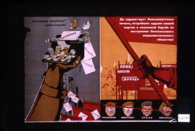



In the Soviet Union, an Uzbek citizen was surrounded by the arts. When not at work in 
the republic’s capital, Tashkent, he or she might pick up a copy of  Mushtum, a magazine 
publishing translations of various literature into Uzbek for citizens to comfortably read. Perhaps 
after picking children up from school, a visit to the theater was in store to see the latest Uzbek 
version of  Hamlet  on stage. Whether or not they realized it, the books, operas, and theater that 
citizens regularly enjoyed as a part of their socialist life were often brought into Tashkent from 
abroad. That same citizen was told under Stalin’s rule that foreign ideas carry capitalist poison, 
and must be ignored. But Tashkent remained connected to literary sources across the Soviet 
Union and Europe after the Great Terror. An analysis of Tashkent’s spatial history through 
translations is complex and requires understanding the map of translations in addition to the 
historical context of literature in the Soviet Union; it was shaped by institutions, political 
pressures, and individual careers. This essay argues that the Great Terror disrupted Tashkent’s 
spatial connections without completely disconnecting it from the international world. It examines 
geographic origins of translated works, comparing the map’s purged, unpurged, and post-purge 
categories, and considers the vast experience of translators working to connect Tashkent to 
various other spaces through literature. Analysis of this map uncovers an intellectual network 
that remained geographically expansive while undergoing significant political and institutional 
change. 

The map represents this network through points marking the geographic origins of 
translated works and their publication locations in Tashkent. Lines connect these locations, with 
works distinguished by whether they were published by a translator who was purged, not purged, 
or who worked post-purges. The map therefore makes it possible to examining not only where 
literature originated, but how Tashkent’s connection to those cities of origin differ across time. 
Its geographic range is considerable. St Petersburg appears repeatedly as an important point of 
origin. It connects Tashkent to works by well-known Russian writers including Pushkin, 
Lermontov, and Gogol. Moscow appears via works by Chekhov and Ostrovsky, while 
Vyoshenskaya introduces works by Sholokhov. Beyond the Soviet Union, London appears 
through Shakespeare’s  Hamlet  and  Othello  . Florence, Jena, and Frankfurt connect Tashkent to 
Italian and German literature. These locations demonstrate that Tashkent’s literary connections 
extended beyond a single Soviet culture, signifying its importance as a global hub for the flow of 
ideas. 

The map’s purged and unpurged categories reveal that geographic origin alone did not 
determine the fate of a translation. St Petersburg is particularly useful for examining this 
distinction. Cho’lpon’s 1936 translation of Pushkin’s  Boris Godunov  is categorized as purged, 
while Oybek’s  Eugene Onegin  , dated in the same year and originating from the same city, is 
unpurged. Qodiriy, who translated Chekhov’s  The Cherry Orchard  from Moscow, was also 
arrested under Stalin. These points complicate the performative nature of politics during the 
Great Terror. Soviet propaganda, including the 1933 poster *The Typewriter of Capitalism*, 
associated Western writing with capitalist influence. This provides context for understanding the 
political suspicion surrounding literary activity originating abroad. However, the map 
complicates any assumption that translating literature from abroad automatically made someone 
a target. Outcomes ranging from international works published after the Great Terror to the 
arrests of writers translating works from within the Soviet Union suggest that the ideological 
crimes committed during this period were much more complex than they were presented to 
citizens. 

The post-purge lines demonstrate that these connections did not disappear after the Great 
Terror. London remains present through Shayxzoda’s 1948 translation of  Hamlet  and Mannon 
Uyg’ur’s 1940 translation of  Othello  . St Petersburg and Moscow are still prevalent, connecting 
traditionally Russian authors to Tashkent repeatedly. The range of these origins suggests that 
translation continued to bring works from different parts of the Soviet Union and Europe into 
Uzbek literary production. The map does not claim or demonstrate that these works were 
selected or published with complete freedom, rather that international literary and artistic 
exchange was preserved in Tashkent despite the politics of the period. 
Benjamin Quénu’s research on Uzbek translation between 1928 and 1953 provides an 
institutional explanation for this continuity. He describes the increased supervision of translators 
through the Writer’s Union of Uzbekistan, which is indicated on the map, and examines how 
increased local and central authorities shaped the conditions of production. Translation fulfilled 
the Soviet goals of cultural modernization, but fits within institutions monitoring its ideological 
output.[^4] Samantha Sherry’s study of translation under Stalin places the map of 
Tashkent’s translations within a broader Soviet context. Her research examines how foreign 
literature remained desirable to Soviet readers, even during heightened focus on limiting foreign 
ideas.[^5] Sherry’s work focuses on translation into Russian in the more traditionally European cities 
of the Soviet Union, and her ideas align with the results of Tashkent’s changed spatial 
connections shown on the map. 

Cho’lpon’s own account adds a dimension that the map cannot convey. In a speech 
delivered at a Writer’s Meeting in 1937, preserved in the Central State Archive of Uzbekistan 
and recently digitized, he discusses his translation work and the difficulty he encountered. He 
describes collaboration with other Uzbek translators and a frequent need to use Russian 
intermediary translations in producing  Hamlet.[^2] The connection is represented 
by a line connecting London and Tashkent directly, but cannot depict the complete route of every 
translation with certainty. The theatrical production of Cho’lpon’s  Hamlet  in Tashkent in 1935 
further demonstrates that translation connected international literature to both print publications 
and performance. A single work could connect Tashkent to an English playwright, 
Russian-language intermediaries, and Uzbek translators. 

> This is a sample quote.
>
> Sample Quote, *Where it came from* (Year), page.[^3]

The map fails to provide an exhaustive list of translations produced during this period. 
Surviving digital records offer a partial view, while the destruction of publications and disruption 
of translator’s careers leave obvious gaps in the corpus. A fuller account would require 
consultation of physical archives. The map also cannot establish a precise route by which every 
work reached Tashkent, nor can it visualize why a particular translator became a victim of the 
Great Terror. Geographic connections reveal the existence and reach of an intellectual exchange 
connecting Tashkent to a broad world, but they cannot independently explain the experience of 
individuals who sustained it. 

The information presented in the map comes from a combination of scholarly research, 
biographical sources, and historical sources. Quénu’s study provides the institutional context for 
Uzbek translation under Stalin, while Sherry’s research helps situate this work within broader 
Soviet censorship norms. The National Encyclopedia of Uzbekistan provides biographical 
information about translators and their careers. Cho’lpon’s 1937 speech provides an important 
primary perspective on translation as a professional practice in the USSR. Together, these 
sources allow the map to demonstrate more than the geographic origins of individual works: they 
reveal Tashkent as a point of connection within a literary network extending across national and 
linguistic boundaries, even through changes in the governing of that network. 

[^1]: Chatterjee, Choi, et al. Russia’s Long Twentieth Century. Abingdon, Oxon, and New York, NY: Routledge, 2016.

[^2] Cho‘lpon, Abdulhamid. “Nutq (1937)” [Speech (1937)]. Prepared by Sherali Turdiev (2012). 
Ziyouz.uz  ,  https://ziyouz.uz/matbuot/jadid-matbuoti/cholpon-nutq-1937/ 

[^3] "Oʻzbekiston milliy ensiklopediyasi" (2005).  National  Encyclopedia of Uzbekistan  . Tashkent: 
National Encyclopedia of Uzbekistan State Scientific Publishing House.

[^4]: Quénu, Benjamin. "From Russian to Uzbek: Unequal Cultural Transfers and Institutional Supervision under Stalinist Rule." 2024.

[^5]: Sherry, S. (2015).  Discourses of Regulation and Resistance: Censoring Translation in the the 
Stalin and Khrushchev Soviet Era  . Edinburgh University Press.

Bibliography 
