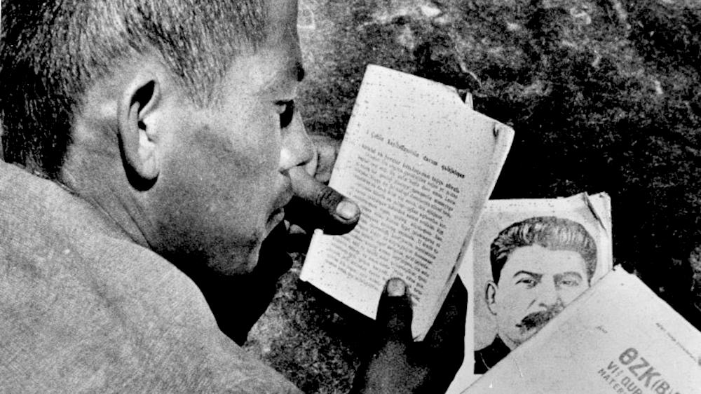



# Tashkent and Its World
A spatial history of Tashkent and the places it was tied to.

## The Map
<iframe src="map/" width="100%" height="520"
style="border:1px solid #ccc; border-radius:8px;"></iframe>

