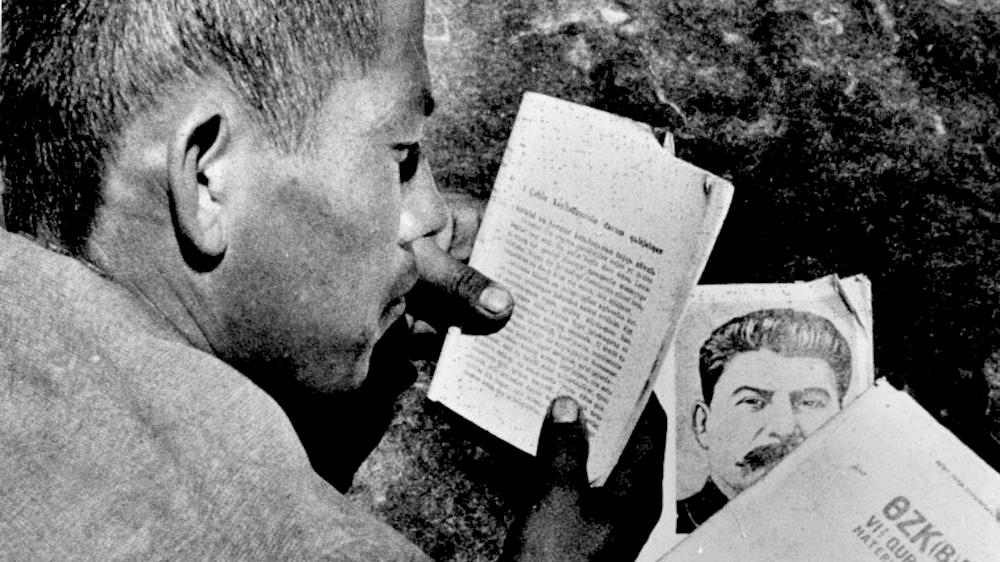



# Tashkent's Translations
A spatial history of Tashkent and the places it was tied to during the time of the Great Terror.

## The Map
<iframe src="map/" width="100%" height="520"
style="border:1 px solid #ccc; border-radius:8 px;"></iframe>

